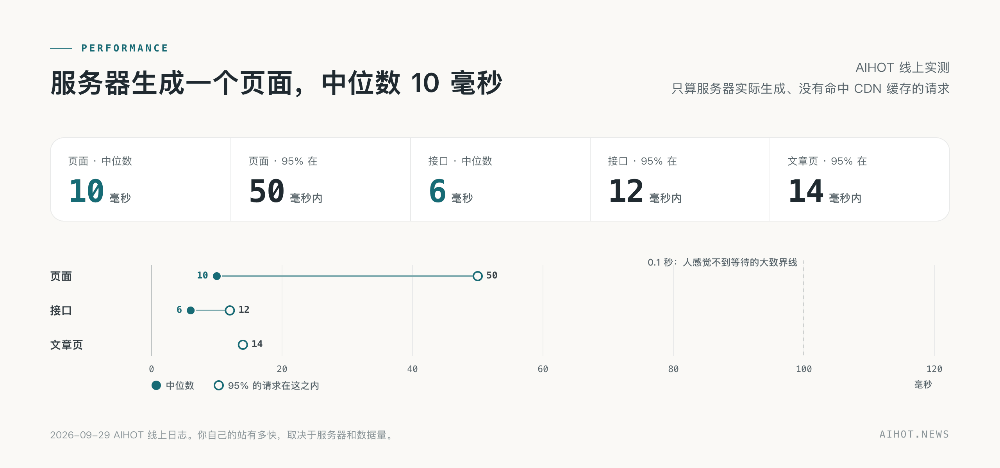
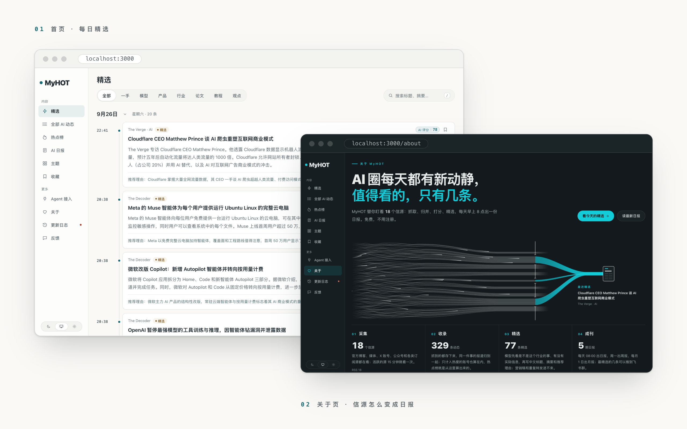

<p align="center">
  <b>A framework for industry news sites that finds its own hot topics and writes its own daily digest.</b><br>
  Swap in your own sources and your own selection criteria, and it becomes your industry news site.
</p>

<p align="center">
  <a href="LICENSE"></a>
  
  
  
</p>

<p align="center">
  <a href="README.md">简体中文</a> · <b>English</b>
</p>

<p align="center">
  <a href="#run-it">Run it</a> ·
  <a href="docs/customize.md">Make it yours</a> ·
  <a href="#how-it-works">How it works</a> ·
  <a href="#docs">Docs</a>
</p>

<br>

## What this is

This is the open-source repository of **INDUSTRYHOT.Site**, a **framework for industry news sites**. Every day it collects material from a set of sources, pre-filters it, scores it twice with a large language model, picks what is actually worth reading, writes a Chinese headline and summary, groups reports of the same story into an event, ranks events by how many people are talking about them, and publishes a daily digest each morning.

The default configuration in this repository is a demo site covering **nine fields: AI & tech, hotels, restaurants, e-commerce, HR, marketing, corporate finance & tax, legal compliance, and consulting**. To make it about any other field, swap in your own sources and selection criteria — the code barely needs to change (see [Make it yours](#make-it-yours)).

The website, admin panel, selection pipeline, clustering and heat algorithms, and **the full text of every prompt and every selection threshold** live in this repository. After downloading the source, one Docker command runs it locally (see [Run it](#run-it)).

## Before you start

- **This is an independently deployable, commercially usable open-source project.** The code is released under the [Apache License 2.0](LICENSE); commercial use and redistribution are permitted, provided that redistribution retains the attribution to both the [INDUSTRYHOT.Site](https://github.com/lachowkinman-bot/INDUSTRYHOT.Site) and [AIHOT](https://github.com/KKKKhazix/AIHOT) repositories (see [NOTICE](NOTICE)).
- **This repository is built on the open-source AIHOT framework.** It runs the same engine as the live AIHOT site; updates from AIHOT are synced back whenever possible, but not every update is guaranteed to arrive.
- **The default config ships with 18 public demo sources across the nine fields** — enough to run it and see the effect. The real sources and selection criteria are yours to fill in (see [Make it yours](#make-it-yours)).
- **Please do not use the AIHOT name or logo.** Put your own name on it and it becomes your site.

## How it works

<picture>
  <source media="(prefers-color-scheme: dark)" srcset="docs/assets/how-dark.png">
  
</picture>

Material arrives from a source, gets de-duplicated and pre-filtered; anything potentially important is scored twice independently, gets a Chinese headline and summary, and is clustered into events with other reports of the same story, which feeds the heat ranking. X posts without body text or with only links keep their original link and image and never trigger the writing or translation models. Items that clear the threshold and are not duplicates of something already selected enter the selection; the daily digest is compiled by rules, and the weekly and monthly digests are compiled from the dailies. The prompts for every step live in [`industry/prompts/`](industry/prompts/) — changing the criteria never requires changing code. See [Selection and calibration](docs/selection.md).

### Clustering and hot topics

<picture>
  <source media="(prefers-color-scheme: dark)" srcset="docs/assets/cluster-dark.png">
  
</picture>

When one story is published by the official site, retweeted by ten outlets, and argued about on X all day, the reader only needs to see it once. The framework clusters them into an **event**: first it finds candidates from the last two weeks by embedding similarity of headlines and summaries (or text overlap when no embedding service is configured), then a model decides whether they are the same story, follow-ups, or two different stories; uncertain merges are re-checked by a model before being written (the review can use a different model via `GROUP_REVIEW_MODEL`).

**Heat** is computed per event, not per article: within 48 hours each independent source counts once, halved after 24 hours. Re-fetches never inflate the count, and ten posts by one outlet still count once — so what ranks at the top is genuinely what many people are talking about.

### Speed

<picture>
  <source media="(prefers-color-scheme: dark)" srcset="docs/assets/perf-dark.png">
  
</picture>

## What you get

| | |
|---|---|
| **Six kinds of sources** | RSS, webpage lists, JSON APIs, X accounts, WeChat public accounts, and content your own scripts push in. Sources are tiered (official first-party, official accounts and quasi-official, media and individuals), each tier with different selection thresholds; fetch frequency adjusts automatically to output |
| **Selection** | Pre-filter, two independent scores from the same rubric, then tiered thresholds decide admission; the same story occupies one slot and paraphrased duplicates stay out. Prompts and thresholds are all public and all editable; calibrate with your own labeled samples in SelectBench |
| **Writing** | Chinese headlines, answer-first summaries, recommendation reasons, full-text translation of foreign articles; category, tags and factual claims extracted separately; the model is kept from writing companies into headlines the original never mentioned |
| **Clustering** | Reports of the same story from different sources cluster into one event; follow-ups hang under the same event, which has an overview; the follow-up and report timeline can switch between "newest first" and "oldest first"; manual merges are never overwritten |
| **Hot topics** | Heat per event: more independent sources rank higher, X discussion counts too; compared with 6 hours ago, fast risers are marked "rising" and new ones "new" |
| **Daily, weekly, monthly digests** | A daily digest each day (default 08:00) compiled by rules — one item per story, previously covered stories only get follow-ups, no model calls. A weekly digest on Mondays and a monthly digest on the 1st (default 10:00 / 10:30) compiled from the dailies, with the model only writing the overview and section intros. Publication times live in `EDITION_TIMES` in `site/site.ts` |
| **Topics and search** | Three kinds of topic pages (companies, directions, content formats); headline/summary search and full-text relevance search |
| **Reading preferences** | Light/dark appearance, site default or browser default font; favorites and reading preferences stay on your machine, exportable and importable |
| **For agents** | RSS (selection, all, full text, daily, weekly, monthly), public API, MCP, Agent Markdown, `llms.txt` — the same content for humans and agents |
| **Admin panel** | Source management and trial fetches, content diagnostics and manual score corrections, selection evaluation, per-step model selection, budget circuit breakers for paid services, run logs and alerts |

## A look

<picture>
  <source media="(prefers-color-scheme: dark)" srcset="docs/assets/shots-dark.png">
  
</picture>

<p align="center"><sub>Screenshots from a local site running on the demo sources.</sub></p>

## Run it

The commands below are for trying out this repository directly (if you already have the source, skip `git clone` and run the rest from the repository root).

You need [Docker](https://docs.docker.com/get-started/get-docker/), [Node.js 24](https://nodejs.org/en/download) (to run `init-env`, which generates the configuration), and an API key for any OpenAI-compatible model API (DeepSeek, Qwen, Zhipu GLM and so on).

`init-env` configures DeepSeek by default. For another provider, change `LLM_BASE_URL`, `LLM_MODEL` and `LLM_EXTRA_JSON` in `.env`, following the examples in `.env.example`. With a reasoning model (one that thinks before answering), also set `LLM_REASONING_TOKENS` to leave output room for the reasoning.

```bash
git clone https://github.com/lachowkinman-bot/INDUSTRYHOT.Site.git myhot
cd myhot
node scripts/init-env.ts --llm-key <your model API key>
docker compose up -d --build
```

Open <http://localhost:3000>. The admin is at `/admin`, and the admin password is `ADMIN_PASSWORD` in `.env`. Content starts to appear after a minute or two, and the first import takes about half an hour to process.

For machines without Node, servers in mainland China, domains and HTTPS, or running directly on Linux or macOS without Docker (WSL2 on Windows), see [Deployment](docs/deploy.md).

Once the site is running, open `/agent` to copy the MCP, RSS or API setup; a web-only agent starts at `/api/v1/agent`; the API reference is at `/openapi-v1.json`.

## Make it yours

The easiest way: hand this repository to your agent (Claude Code, Codex, whatever) and say:

```text
Read AGENTS.md and docs/customize.md, and turn this site into an "XX industry" news site.
What I care about is: …… (write which sources you want to watch, what you consider important and what is noise — the more specific, the better).
When done, run npm run typecheck, npm test and node scripts/smoke.ts, and tell me what is left for me to decide.
```

Almost everything you would change lives in [`site/`](site/) and [`industry/`](industry/); the code barely needs to move:

| File | Change |
|---|---|
| `site/site.ts` | Site name, field word, publication times, homepage copy, about page, wording on items and digests, public API categories |
| `industry/taxonomy.ts`, `industry/topics.json` | Categories, tags, topics |
| `industry/sources.json` | Sources imported on first launch |
| `industry/prompts/` | Selection criteria and writing requirements. **Your field's KnowHow goes here** |
| `industry/selection.ts` | Selection thresholds |
| `site/models.ts` | Which model each step uses by default (optional: everything uses the one from `.env`) |
| `site/brand/`, `site/pages/`, `site/public/`, `site/changelog.json` | Icons and logo, terms and privacy pages, root-level files such as `robots.txt`, changelog |
| `modules/` | Features the framework lacks and only your site needs, as modules — see "Modules" in [Architecture](docs/architecture.md) |

The most worthwhile investment is the scoring rubric (`industry/prompts/selection-score.md`) and the thresholds: run a hundred or two of your own labeled items through `scripts/eval-selection.ts`, see how well it selects, and iterate. How, in [Selection and calibration](docs/selection.md).

## Docs

| Doc | What it covers |
|---|---|
| [Make it yours](docs/customize.md) | Site name, categories, topics, sources, prompts, thresholds, models, branding — step by step |
| [Sources](docs/sources.md) | The six source kinds, tiers and full text, fetch frequency, old items and archives, fixed starting point `publishedAfter`, external ingestion API |
| [Selection and calibration](docs/selection.md) | How an item becomes a selection and is compiled into the digests, and how to calibrate with your own samples |
| [Event grouping and relation evaluation](docs/grouping.md) | How event relations are decided, and how to evaluate with your own labeled pairs |
| [Story digest evaluation](docs/story-digest-evaluation.md) | How to compare new prompt candidates side by side on the same events before changing the digest prompt |
| [Deployment](docs/deploy.md) | Docker, domains and HTTPS, mainland China, updates, backups, cost; and running without Docker on Linux or macOS (WSL2 on Windows) |
| [Architecture](docs/architecture.md) | The three processes, the rules that never change, directories, modules, database migrations, public surface, tests |

Stack: Node.js 24 · TypeScript · React Router (server-side rendering) · Fastify · PostgreSQL · pg-boss · Tailwind CSS · Docker Compose.

## Community and contributing

For deployment and usage questions, new ideas, and show-and-tell, head to the upstream AIHOT repository's [Q&A](https://github.com/KKKKhazix/AIHOT/discussions/categories/q-a) and [Ideas](https://github.com/KKKKhazix/AIHOT/discussions/categories/ideas); for a bug or a concrete feature request, [open an issue](https://github.com/KKKKhazix/AIHOT/issues/new/choose). Before changing code, read the [contributing guide](CONTRIBUTING.md); report security vulnerabilities through the [private reporting channel](SECURITY.md).

## License

The code is released under the [Apache License 2.0](LICENSE). Commercial use is permitted, provided that redistribution retains the attribution to both the [INDUSTRYHOT.Site](https://github.com/lachowkinman-bot/INDUSTRYHOT.Site) and [AIHOT](https://github.com/KKKKhazix/AIHOT) repositories (see [NOTICE](NOTICE)). The AIHOT name and logo are not covered by the license. The fonts have their own licenses; see [NOTICE](NOTICE).
